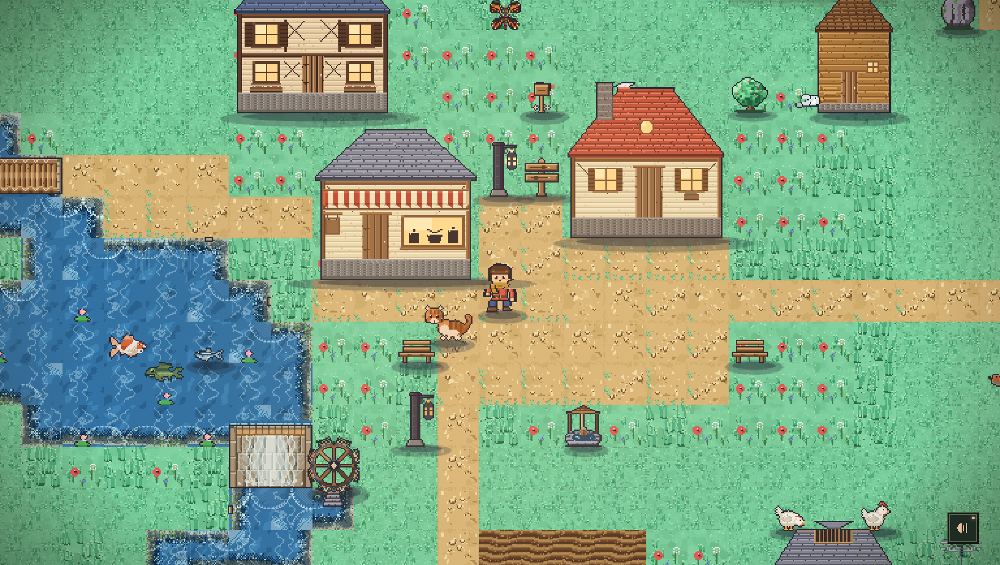
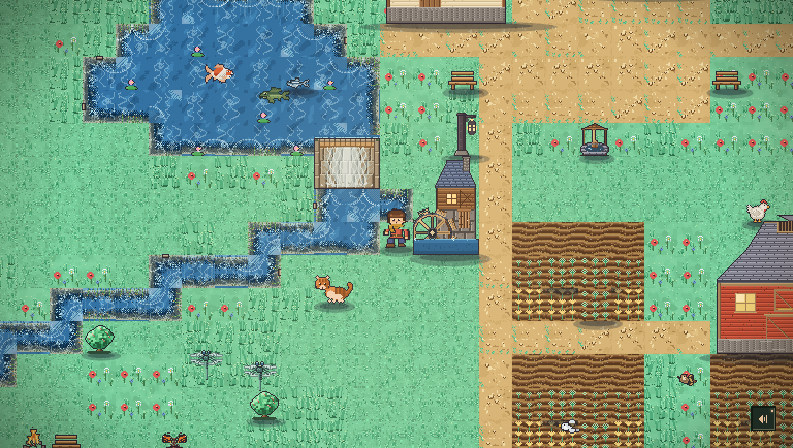
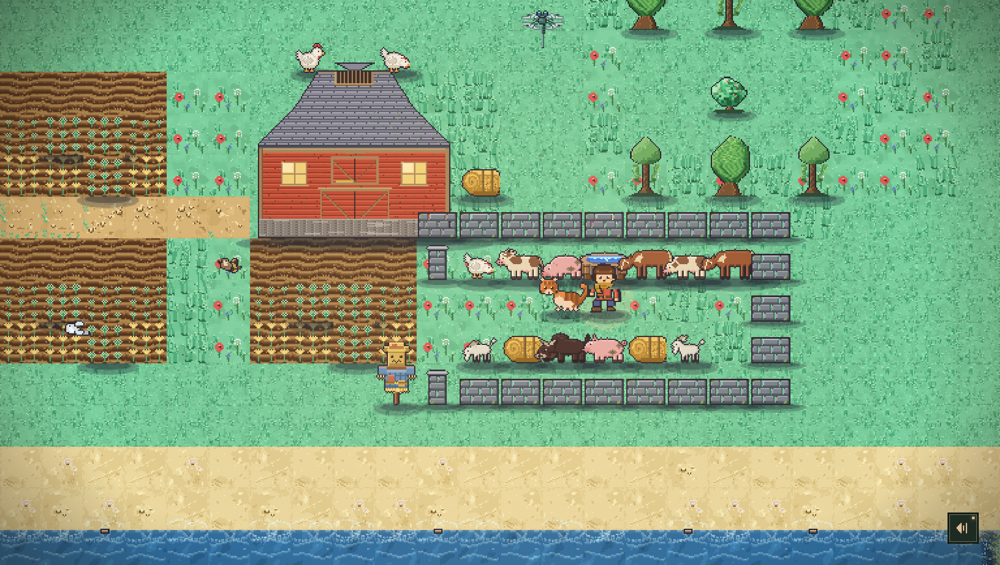

# Pixelworld

A cozy 2.5D pixel-art world you can walk through. One hand-built 64x44-tile map with a river that runs from a mountain lake all the way to the sea, a village square, a farm, a stone-walled paddock, a dense forest, and a small tabby cat that follows you everywhere — meowing when she notices you've wandered off.

No game engine. A custom canvas renderer, sprites stored as pure data, and a fully procedural Web Audio soundscape. Built with Nuxt and TypeScript.

<p>
  
  
</p>

## The world

| Region | What lives there |
| --- | --- |
| **Mirror Lake Uplands** (NW) | A mountain lake framed by massifs, feeding the stream that becomes the river |
| **The Village** (center) | The spawn square: cottage, store, two-story timber house, well, flower garden, lamps, benches |
| **Willow Pond** | The stream widens into a pond, held back by a stone dam with a water-wheel **mill house** grinding beside it |
| **Sunroot Farm** | Three tidy field strips, a barn, a scarecrow, and chickens |
| **The Meadow Pasture** | A grey fieldstone wall with capstoned gateposts encloses cows, a bull, horses, goats, and pigs, with their trough and hay inside |
| **Eastwind Lookout** (SW) | A dense hundred-tree forest with a winding path, a hidden clearing, and the lookout |
| **The Old Orchard** (E) | Neat oak and willow rows with bee skeps |
| **Saltgrass Shore** (S) | The river flares into a delta and meets the sea; rowboat, driftwood, gulls, and a lazy swell |

Thirteen landmarks are scattered across it, each with its own sound cue and a short message when you stand beside it.

## Features

- **A living companion cat** — a chibi tabby with a delayed trail: she strolls behind you, notices when you've moved, trots over (meowing), and free-roams, sits, and stares when you idle.
- **Real water** — the river meanders, spills over the dam as a cascade, sheets through the arch bridge, and ends in a delta; the sea carries slow swells. Fish rings stay near their anchors.
- **Water power** — the mill house wheel turns through four 45-degree frames beside the pond dam; the windmill's sails step the same way on its knoll.
- **Procedural sound** — wind gusts, river babble, sea wash, leaf rustle, footsteps, landmark cues, and the cat's meow are all synthesized at runtime through a Web Audio graph. No audio files, no hums.
- **Movement** — WASD, arrow keys, or a touch-drag joystick, with wall-sliding collision against every solid object.
- **Calm by design** — ground tiles never animate; motion lives only in props (campfire, lamps, windmill, mill wheel) and the unhurried birds and bugs crossing the whole map.

## Controls

| Input | Action |
| --- | --- |
| `W A S D` / arrow keys | Walk |
| Click / touch + drag | Floating-joystick walk |
| Any first gesture | Unmutes the ambience |
| `M` | Toggle forest sounds |

## Screenshots

<p>
  
  
</p>

## Tech

- **Nuxt 4 + TypeScript**, `pnpm`, zero runtime game-engine dependencies.
- **Renderer**: one custom canvas class draws a static ground pass, per-tile water overlays, and depth-sorted sprites with flat dab shadows (`app/utils/world-renderer.ts`).
- **Sprites**: pure data — equal-width row strings plus palettes. Large buildings are composed programmatically from stone and timber runs; small critters are hand-authored.
- **Map**: `app/utils/world-map.json` — 44 rows of 64 ground characters, ~330 objects, 13 landmarks. Deck characters (`B` bridge, `D` dam, `A` arch) are walkable water crossings.
- **Audio**: a Web Audio graph built after the first user gesture (`app/composables/useWorldSounds.ts`), with distance-gated ambience bands for the river, sea, and landmarks.

## Project structure

```
app/
  components/pixel/PixelWorld.vue   # viewport, movement, collision, the cat's brain
  components/pixel/WorldAudio.vue   # the sound toggle
  composables/usePlayerControls.ts  # keys + touch joystick -> movement axis
  composables/useWorldSounds.ts      # procedural Web Audio ambience
  utils/
    world-map.json                   # the map: ground rows, objects, landmarks
    world-map.ts                     # typed access + collision grid
    world-renderer.ts                # the canvas renderer
    world-animation.ts               # frame schedules (props only)
    pixel-sprite-compose.ts          # shared sprite composer helpers
    pixel-sprite-buildings.ts        # cottage, store, windmill, well, house, hut,
                                     # mudHut, waterWheel, waterWheelHouse
    pixel-sprite-farm.ts             # barn, campfire, scarecrow, hay, chickens, crops
    pixel-sprite-animals.ts          # cow, bull, horse, goat, pig
    pixel-sprite-cat.ts              # the companion cat
    pixel-sprite-cozy.ts             # bench, picnic blanket, mailbox, bee skep,
                                     # stone wall, gatepost
    pixel-sprite-bank.ts             # the single integration point the renderer reads
test/
  world-map.test.mjs                 # 15 tests over the map contract
```

## Getting started

```bash
pnpm install

# dev server
pnpm dev

# production build + preview
pnpm build
node .output/server/index.mjs

# map contract suite (15 tests)
pnpm test
```

Open `http://localhost:3000` (dev) or the port Nitro prints (production). The world is fully playable with a keyboard or touch.

## Testing

`pnpm test` runs the map contract suite with `node --test`: dimensions and charset, one connected waterway across lake, river, and sea, exact crossing tiles with walkable banks, all 13 landmarks reachable from spawn, the stone paddock enclosure with the full herd inside, forest density and species balance, zero fences, and object footprint hygiene (nothing sits on water, cliffs, decks, or lanes).
